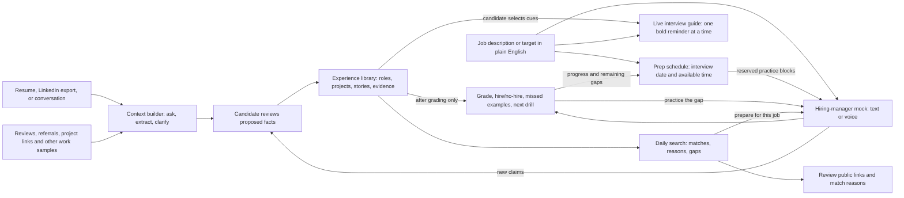

# Interview Prep

**Runnable interview preparation studio | Local-first, no live payments**

Build a private interview coach around an **editable evidence library**, not a chat transcript. A candidate can tell a story, attach a performance review or referral, or link a project, then confirm what the evidence says about their contribution. The same example can inform mock feedback, an application, or a short reminder during a real interview where notes are permitted.

**Launch recommendation:** start with US-based, English-speaking mid-career software engineers preparing for a hiring-manager or behavioral round in the next two weeks. Prove that a second practice answer gets better. Add daily job discovery after candidates trust the coach with their experience; don't start by building another job board.

### Run the practice studio

With the .NET 10 SDK, Node 20.10+ with npm, PowerShell 7.3+ and a local Linux Docker engine (ARM64 or AMD64), run:

```powershell
.\scripts\model.ps1 install   # once: pinned llama.cpp image + 1.12 GB of verified model weights
.\dev.ps1 up                 # starts/connects the installed model and serves the studio
```

Open **http://127.0.0.1:5187** and choose **Open my local workspace**. Chat opens first. The bundled setup runs Apache-licensed **Qwen2.5-1.5B-Instruct Q4_K_M** on CPU. It binds the inference API to `127.0.0.1:5191`, uses a private bearer key and caps Docker at three CPUs and 2.1 GB. The model, key and database stay out of Git. The first cold load can take a few minutes. To release the model’s memory, run `.\scripts\model.ps1 stop`; `up` reconnects it on the next start. The fictional sample and an explicitly labeled offline coach work without Docker or a model installation. No cloud AI key, account or card is required.

| In the studio | What you can do |
| --- | --- |
| **Chat** | Type your own message, or edit a starter to add job history, practice an interview question, find jobs, or plan an interview. You can switch topics in the same conversation. Press **Enter** to send or **Shift+Enter** for a new line. Model replies appear as they’re written. Choose **Stop reply** to cancel and edit your message; unfinished previews aren’t saved. Start a separate **mock interview** only when you want a scored round. |
| **Find jobs in chat** | Confirm a public role title. The coach compares returned links with your messages, agent memory and job history **locally** and explains the title overlap. Verify openings with the employer. After a search you can say yes to a daily run, or leave it as a one-off. **Account → Run my job search daily** controls the same setting. Earlier results remain in **Search chats → Saved job searches**. |
| **Agent memory** | View, edit or delete what the coach remembers. Say **Remember: keep questions short** for a coaching preference. Work examples from question practice and mocks also create memories; editing a memory does not rewrite your transcript, score or job history. |
| **Job experience** | Drop a document here or in Chat, choose a file on mobile, or paste text. A new chat reads the attachment and searches your existing job history. It saves a short description under **Saved sources**, adds cited statements, links clear matches, and asks about uncertain ones. No title, category or excerpt selection needed. Supports text PDFs, DOCX, TXT, Markdown and CSV; no OCR. A pasted profile or project URL stays a bookmark. |
| **Schedule** | Tell Chat about an upcoming interview; give the company, role, description and date. Choose whether to research the company, review a prep packet, then confirm practice times before anything is booked. In Schedule, start mocks, move or skip blocks, export reminders, compare readiness over time, and open live reminder cards. |

**How recall works:** the local coach can call `search_workspace`, a bounded search over this workspace’s current experience, previous messages and agent memory. This is retrieval, not model training. A work example adds a cited statement or supports an existing one without changing its wording or permissions. New statements need review and cannot go into applications by default. A linked memory follows corrections to its statement unless you edit the memory separately. Deleting a chat removes its notes and claims supported only by that chat. Scored mocks use the role, questions and submitted answers, never recalled facts.

**Document privacy:** an import chat keeps the readable attachment text locally until analysis succeeds or you delete the pending chat. The original binary and embedded attachments are not stored. To omit private details, paste an edited copy. Failed analyses can be retried without changing history. New statements are unconfirmed; existing approvals never transfer to new wording. See the [agent harness and search decision](docs/architecture.md#document-import-agent-and-search).

**Privacy and storage:** SQLite is **not encrypted by the app**. Use synthetic material on a shared machine. On Windows the default directory is `%LOCALAPPDATA%\InterviewPrep`; set `INTERVIEW_PREP_DATA` to a private directory to override it. The local workspace cookie lasts 30 days. Delete the workspace before clearing the cookie to remove records immediately. Schema upgrades preserve existing workspace identities and default new permissions to **off**. Do not expose the desktop server through a tunnel.

### Optional integrations

`dev.ps1 up` enables the keyless public jobs index. Other integrations below require configuration. Set environment variables on the host, not in source control.

| Feature | Activation and limits |
| --- | --- |
| Alternative local AI | Instead of the bundled service, set `INTERVIEW_PREP_MODEL_PORT`, optional `INTERVIEW_PREP_MODEL_ID` and optional `INTERVIEW_PREP_MODEL_KEY_FILE` for a trusted, loaded OpenAI-compatible model on `127.0.0.1`. The local coach receives bounded, labeled private context for builder conversations. Grading sees only the role, actual questions and answers. A chat scorecard explicitly identifies a failed model assessment if it uses the offline wording checklist. A small local model is not a calibrated hiring assessor. |
| Practice voice | An installed on-device English speech recognizer and local reading voice require no server. Alternatively point `INTERVIEW_PREP_SPEECH_PORT` at a trusted loopback whisper.cpp `/inference` server. Each opted-in practice recording is capped at 45 seconds and is not saved by the studio. Captions stay editable until submitted. The live guide never uses that server. |
| Company research | With consent, planning can check fixed official pages for Amazon/AWS, Microsoft and Google without credentials. Unavailable, curated and live sources are labeled. `INTERVIEW_PREP_BRAVE_SEARCH_KEY` enables public searches using only the public company name. `INTERVIEW_PREP_LICENSED_THEMES` can point to a private JSON array with `company`, `publisher`, HTTPS `url`, `theme` and ISO `expiresAt`. Glassdoor is not scraped, and practice questions are not represented as actual employer questions. |
| Public job search | Locally, the [Hacker News jobs index](https://hn.algolia.com/api) supplies up to five recent public job links without a key, mainly startup and technology roles. For a published host set `INTERVIEW_PREP_HN_JOB_SEARCH=1` to opt in, or `0` to disable that source. For broader coverage, `INTERVIEW_PREP_OPENAI_SEARCH_KEY` selects [OpenAI web search](https://developers.openai.com/api/docs/guides/tools-web-search) instead; `INTERVIEW_PREP_OPENAI_SEARCH_MODEL` overrides its model. This paid path uses `store=false`, up to two tool calls and a 45-second deadline. Only the confirmed public title goes out. No provider receives private matching context, and no search generates applications or outreach. `INTERVIEW_PREP_SCOUT_SEARCH_REPLAY_FILE` uses recorded citations without live lookup. Opted-in daily searches run **while the host is running** and appear in chat history. |
| Accounts and tiers | To enable verified email-link sign-in, configure email-link auth and the authorized origin in your own Firebase project, then set `INTERVIEW_PREP_FIREBASE_PROJECT` and `INTERVIEW_PREP_FIREBASE_WEB_API_KEY`. Account and local workspaces are separate; they are never merged by email. The local sandbox is unmetered. Verified Free has starter grants; Prep has period allowances. **No live price or checkout.** |
| Test billing | Only a separately configured test installation can use Stripe: `INTERVIEW_PREP_STRIPE_MODE=test`, `INTERVIEW_PREP_PUBLIC_ORIGIN`, `INTERVIEW_PREP_STRIPE_TEST_SECRET_KEY`, `INTERVIEW_PREP_STRIPE_TEST_PRICE_ID` and `INTERVIEW_PREP_STRIPE_TEST_WEBHOOK_SECRET`. Use only test credentials, a test monthly Price and the signed `/api/billing/webhook`. Checkout redirects do not grant access; reconciled test subscriptions do. |

`.\dev.ps1 test` exercises schema upgrades, workspace isolation, chat recall, booking, scorecards, scout reports and mobile browser journeys against isolated fixtures (Chrome/Edge/Chromium required; `INTERVIEW_PREP_BROWSER` overrides the executable). `.\dev.ps1 eval replay` tests model protocol and rejection paths, **not model quality**. After building Release, `.\scripts\model.ps1 connect` followed by `node --test .\tests\model-live.mjs` exercises genuine local inference with synthetic data and a temporary workspace. `/healthz` reports the application version; `/readyz` checks database connectivity.

The root `Dockerfile` builds a non-root image. For live hosting, the [Azure demo deployment runbook](docs/deploy-demo.md) sets up GitHub Actions, OIDC, a registry and two Azure Container Apps rings. The **public demo** serves the fictional sample only: no workspaces, database, background workers, billing or paid searches. Production requires a tested staging digest and approval. Running the studio locally does not provision Azure or enable releases. Hosting real candidate data requires a separate persistence, backup and identity rollout.

To try the coach, mock interview and public job scout with a real model, use the separate [private, 24-hour Azure test](docs/private-test.md). It requires the designated Microsoft Entra user and fictional inputs. It does not activate the public demo or production.



### Decisions worth making early

| Decision | Why it matters |
| --- | --- |
| Ordinary chat, scored mocks and a separate live guide | Chat and mock answers can *propose* facts; only the candidate can confirm them. Scored mocks stay unassisted. In an actual interview the candidate can open an ungraded [cue-card view](docs/experience.md#live-interview-guide). |
| Grade the performance, not the person | Every completed mock gets a rubric grade and a simulated hire/no-hire call. Score the transcript before looking for unused stories. Never claim to predict an employer's decision. |
| Keep the first deployment small | One responsive web app, one .NET application with API and worker entry points, one transactional Postgres database. Queue long work; don't put a swarm of agents, a graph database, or live web research in the conversational hot path. |
| Buy access, not scraping risk | LinkedIn sign-in is not a work-history feed. Glassdoor is an optional, rights-gated research source, not a launch dependency. The daily search finds links; it never applies or contacts an employer. |
| Keep a useful free tier | A fictional demo needs no account. Free includes a real graded text mock without a card. [Prep](docs/operations.md#billing-and-unit-economics) adds repeated mocks, voice and discovery; its price is undecided. No auto-conversion or overages. |

### Design packet

| Read | Use it to decide |
| --- | --- |
| [Candidate experience](docs/experience.md) | Evidence uploads, a worked [prep schedule and readiness history](docs/experience.md#interview-prep-schedule-and-readiness), live reminders, voice practice and a next-day digest. |
| [Architecture and request flows](docs/architecture.md) | What to reuse from Understory, which boxes to deploy, agent tool boundaries, request sequences, and degraded paths. |
| [Data model and memory](docs/data-model.md) | Entities, keys, tenant boundaries, provenance, session recall, correction and deletion semantics. |
| [Operating the service](docs/operations.md) | Identity, billing, unit economics, model evaluation, SLOs, alerts, incident response and recovery. |
| [Delivery and contributor skills](docs/delivery.md) | Proposed monorepo, AI-assisted development workflows, CI/CD, release gates and a solo-team build order. |
| [Release rings and GitHub Actions](docs/releases.md) | Staging -> production only; immutable promotion, manual approval, cloud activation and rollback. |
| [Market and validation](docs/market.md) | Direct competitors, substitutes, sourced pricing, distribution, and experiments that could disprove the idea. |

**First vertical slice:** given a pasted job description and one project described in chat, let a candidate confirm a fact, complete a text mock, see a defensible decision, and retry the weakest answer. If this is no more useful than a general chatbot with the same inputs, voice polish and more job feeds won't fix it.
