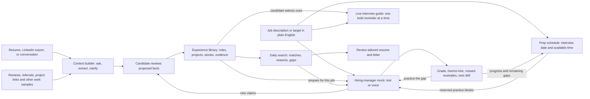

# Interview Prep

**Local practice alpha + product design | No deployed service or billing**

Build a private interview coach around an **editable evidence library**, not a chat transcript. A candidate can tell a story, attach a performance review or referral, or link a project, then confirm what the evidence says about their contribution. The same example can inform mock feedback, an application, or a short reminder during a real interview where notes are permitted.

**Launch recommendation:** start with US-based, English-speaking mid-career software engineers preparing for a hiring-manager or behavioral round in the next two weeks. Prove that a second practice answer gets better. Add daily job discovery after candidates trust the coach with their experience; don't start by building another job board.

### Run the practice studio

With the .NET 10 SDK, Node 20.10+ with npm, and PowerShell 7.3+, run:

```powershell
.\dev.ps1 up
```

Open **http://127.0.0.1:5187**. Try the fictional browser-only exercise or open a separate local workspace. Describe a project, edit and confirm a statement, then paste a target role, answer four mock questions, review the debrief and retry one answer without changing the original grade. Submitted answers survive closing the browser or restarting the app.

The default is a **guided self-assessment**, not an AI grading service. For model-assisted practice, run a trusted **local** llama.cpp-compatible server with a model already loaded, set `$env:INTERVIEW_PREP_MODEL_PORT = '8080'` to its loopback port, and restart the studio. Tailoring questions and assessing answers are separate opt-ins. The assessor sees the role, the questions actually asked, and the answers, never the experience library. The app downloads no models, uses no cloud API key, and does not substitute a verdict when the model fails.

**Privacy boundary:** this is for local development, not a hosted multi-user service. A 30-day HTTP-only browser cookie unlocks one workspace. SQLite stores its contents on the local disk, **not encrypted by the app**; use synthetic material on a shared machine. On Windows the default location is `%LOCALAPPDATA%\InterviewPrep`; set `INTERVIEW_PREP_DATA` to a private directory to override it. Use **Delete my workspace** before clearing browser cookies if you want the records removed immediately. Expired workspaces are purged on startup. Do not expose the loopback server through a tunnel.

`.\dev.ps1 test` runs the API and real-browser journey against temporary databases (Chrome/Edge/Chromium required; `INTERVIEW_PREP_BROWSER` can point at its executable). `.\dev.ps1 eval replay` exercises the model protocol with a synthetic local fixture: it tests grounding and failure handling, **not model quality**. Sign-in, Postgres, document import, voice, schedules, scouting, billing and cloud deployment remain planned.



### Decisions worth making early

| Decision | Why it matters |
| --- | --- |
| Two agent sessions and a separate live guide | The builder and mock interviewer can *propose* facts; only the candidate can confirm them. Scored mocks stay unassisted. In an actual interview the candidate can open an ungraded [cue-card view](docs/experience.md#live-interview-guide): **Mention the rollback pilot.** Then: **What changed as a result?** |
| Grade the performance, not the person | Every completed mock gets a rubric grade and a simulated hire/no-hire call. Score the transcript before looking for unused stories. Never claim to predict an employer's decision. |
| Keep the first deployment small | One responsive web app, one .NET application with API and worker entry points, one transactional Postgres database. Queue long work; don't put a swarm of agents, a graph database, or live web research in the conversational hot path. |
| Buy access, not scraping risk | LinkedIn sign-in is not a work-history feed. Glassdoor is an optional, rights-gated research source, not a launch dependency. The daily agent drafts for the candidate; it never applies or contacts an employer. |
| Keep a useful free tier | A fictional demo needs no account. Free includes a real graded text mock without a card. [Prep](docs/operations.md#billing-and-unit-economics) adds repeated mocks, voice and discovery; its price is undecided. No auto-conversion or overages. |

### Design packet

| Read | Use it to decide |
| --- | --- |
| [Candidate experience](docs/experience.md) | Evidence uploads, a worked [prep schedule and readiness history](docs/experience.md#interview-prep-schedule-and-readiness), live reminders, voice practice and a next-day digest. |
| [Architecture and request flows](docs/architecture.md) | What to reuse from Understory, which boxes to deploy, agent tool boundaries, request sequences, and degraded paths. |
| [Data model and memory](docs/data-model.md) | Entities, keys, tenant boundaries, provenance, session recall, correction and deletion semantics. |
| [Operating the service](docs/operations.md) | Identity, billing, unit economics, model evaluation, SLOs, alerts, incident response and recovery. |
| [Delivery and contributor skills](docs/delivery.md) | Proposed monorepo, AI-assisted development workflows, CI/CD, release gates and a solo-team build order. |
| [Release rings and GitHub Actions](docs/releases.md) | Staging -> production only; immutable promotion, manual approval, cloud activation and rollback. |
| [Market and validation](docs/market.md) | Direct competitors, substitutes, sourced pricing, distribution, and experiments that could disprove the idea. |

**First vertical slice:** given a pasted job description and one project described in chat, let a candidate confirm a fact, complete a text mock, see a defensible decision, and retry the weakest answer. If this is no more useful than a general chatbot with the same inputs, voice polish and more job feeds won't fix it.
