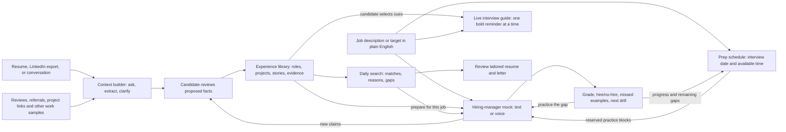

# Interview Prep

**Runnable interview preparation studio | Local-first, no live payments**

Build a private interview coach around an **editable evidence library**, not a chat transcript. A candidate can tell a story, attach a performance review or referral, or link a project, then confirm what the evidence says about their contribution. The same example can inform mock feedback, an application, or a short reminder during a real interview where notes are permitted.

**Launch recommendation:** start with US-based, English-speaking mid-career software engineers preparing for a hiring-manager or behavioral round in the next two weeks. Prove that a second practice answer gets better. Add daily job discovery after candidates trust the coach with their experience; don't start by building another job board.

### Run the practice studio

With the .NET 10 SDK, Node 20.10+ with npm, and PowerShell 7.3+, run:

```powershell
.\dev.ps1 up
```

Open **http://127.0.0.1:5187**. Try the fictional browser-only exercise, or choose **Open my local workspace**. No account, API key, model download, or card is needed. Submitted turns, confirmed facts, schedules and results survive a restart.

| In the studio | What you can do |
| --- | --- |
| **Experience builder** | Resume a conversation about roles, projects, decisions and results. Preview a resume, LinkedIn export, performance review or referral on-device; redact a passage before saving it. PDF with selectable text, DOCX and text are supported; no OCR or LinkedIn scraping. Inspect provenance, resolve conflicting claims and export a base resume. Draft and live use require separate permissions. |
| **Targets & schedule** | Describe a role, import a JD, bookmark its URL, or fill details from a followed, rights-cleared posting. Review dated company references and any licensed interview themes. Preview, move or skip preparation blocks and export calendar reminders. Start scheduled mocks and compare like-for-like results across the last 30 days. |
| **Practice round** | Answer four hiring-manager probes by text or local dictation. Get a rubric grade and simulated hire/no-hire decision using a local model, an explicitly limited offline wording screen, or self-assessment. Review answer citations, alternative framing, unused examples and proposed new memories. Rate or challenge a finding and retry the weakest answer without changing the original grade. |
| **Live reminders** | Prepare and approve up to five short cards. When the interview permits notes, open a one-line, manual guide. Optional topic selection requires everyone's consent and a verified on-device recognizer. Neither mode creates a real-interview transcript, score, or automatic memory. |
| **Job scout** | Set a role, constraints, timezone and delivery time. Get an in-app daily digest with reasons, gaps and next steps. Review a tailored resume/letter pair from explicitly permitted facts, approve it and export text, Word, or print/PDF. Edited or revoked evidence invalidates the old pair. Nothing applies or contacts employers. |

**Privacy and storage:** SQLite is **not encrypted by the app**. Use synthetic material on a shared machine. On Windows the default directory is `%LOCALAPPDATA%\InterviewPrep`; set `INTERVIEW_PREP_DATA` to a private directory to override it. The local workspace cookie lasts 30 days. Delete the workspace before clearing the cookie to remove records immediately. Schema upgrades preserve existing workspace identities and default new permissions to **off**. Do not expose the desktop server through a tunnel.

### Optional integrations

All are off by default. Set these in the process environment and restart the studio; never commit keys or private catalogs.

| Feature | Activation and limits |
| --- | --- |
| Local AI | Point `INTERVIEW_PREP_MODEL_PORT` at a trusted, already-loaded llama.cpp-compatible `/v1/chat/completions` server on `127.0.0.1`. Builder extraction, question tailoring, adaptive probes and model grading are explicit choices. Grading sends the target, actual questions and answers, **not** the experience library. Invalid citations are rejected. A wording screen is a checklist, not AI; it is never silently substituted for a failed model. |
| Practice voice | An installed on-device English speech recognizer and local reading voice require no server. Alternatively point `INTERVIEW_PREP_SPEECH_PORT` at a trusted loopback whisper.cpp `/inference` server. Each opted-in practice recording is capped at 45 seconds and is not saved by the studio. Captions stay editable until submitted. The live guide never uses that server. |
| Company research | Known companies have curated official links. `INTERVIEW_PREP_BRAVE_SEARCH_KEY` enables a fresh search only after approval to send the public company name. `INTERVIEW_PREP_LICENSED_THEMES` can point to a private JSON array with `company`, `publisher`, HTTPS `url`, `theme` and ISO `expiresAt`. Supply only licensed material; expired themes are not presented. Glassdoor is not scraped. |
| Job sources | Private pasted listings work offline. `INTERVIEW_PREP_SCOUT_BOARDS` is a comma-separated allowlist of rights-cleared `greenhouse:slug` or `lever:slug` boards; the candidate also has to follow the board. `INTERVIEW_PREP_SCOUT_REPLAY_DIR` reads `<provider>.<slug>.json` fixtures instead of making network requests. The scheduler runs **while the host is running**, catches up the latest due local day and deduplicates manual/automatic runs. Digests are in-app, not email. |
| Accounts and tiers | To enable verified email-link sign-in, configure email-link auth and the authorized origin in your own Firebase project, then set `INTERVIEW_PREP_FIREBASE_PROJECT` and `INTERVIEW_PREP_FIREBASE_WEB_API_KEY`. Account and local workspaces are separate; they are never merged by email. The local sandbox is unmetered. Verified Free has starter grants; Prep has period allowances. **No live price or checkout.** |
| Test billing | Only a separately configured test installation can use Stripe: `INTERVIEW_PREP_STRIPE_MODE=test`, `INTERVIEW_PREP_PUBLIC_ORIGIN`, `INTERVIEW_PREP_STRIPE_TEST_SECRET_KEY`, `INTERVIEW_PREP_STRIPE_TEST_PRICE_ID` and `INTERVIEW_PREP_STRIPE_TEST_WEBHOOK_SECRET`. Use only test credentials, a test monthly Price and the signed `/api/billing/webhook`. Checkout redirects do not grant access; reconciled test subscriptions do. |

`.\dev.ps1 test` exercises the schema upgrade, API, accounts, jobs, document formats and browser journeys against isolated fixtures (Chrome/Edge/Chromium required; `INTERVIEW_PREP_BROWSER` overrides the executable). `.\dev.ps1 eval replay` tests the model protocol and rejection paths, **not model quality**. `/healthz` reports the application version; `/readyz` checks database connectivity.

The root `Dockerfile` builds the same web/API and in-process workers into a non-root image. Container mode disables anonymous data workspaces; the fictional sample still works. Staging and production promotion remain gated. The current persistence implementation is SQLite, not the proposed multi-instance PostgreSQL service. Production ingress, backups, monitoring destinations and cloud deployment are **not provisioned by running the studio**.



### Decisions worth making early

| Decision | Why it matters |
| --- | --- |
| Two agent sessions and a separate live guide | The builder and mock interviewer can *propose* facts; only the candidate can confirm them. Scored mocks stay unassisted. In an actual interview the candidate can open an ungraded [cue-card view](docs/experience.md#live-interview-guide): **Mention the rollback pilot.** Then: **What changed as a result?** |
| Grade the performance, not the person | Every completed mock gets a rubric grade and a simulated hire/no-hire call. Score the transcript before looking for unused stories. Never claim to predict an employer's decision. |
| Keep the first deployment small | One responsive web app, one .NET application with API and worker entry points, one transactional Postgres database. Queue long work; don't put a swarm of agents, a graph database, or live web research in the conversational hot path. |
| Buy access, not scraping risk | LinkedIn sign-in is not a work-history feed. Glassdoor is an optional, rights-gated research source, not a launch dependency. The daily agent drafts for the candidate; it never applies or contacts an employer. |
| Keep a useful free tier | A fictional demo needs no account. Free includes a real graded text mock without a card. [Prep](docs/operations.md#billing-and-unit-economics) adds repeated mocks, voice and discovery; its price is undecided. No auto-conversion or overages. |

### Design packet

| Read | Use it to decide |
| --- | --- |
| [Candidate experience](docs/experience.md) | Evidence uploads, a worked [prep schedule and readiness history](docs/experience.md#interview-prep-schedule-and-readiness), live reminders, voice practice and a next-day digest. |
| [Architecture and request flows](docs/architecture.md) | What to reuse from Understory, which boxes to deploy, agent tool boundaries, request sequences, and degraded paths. |
| [Data model and memory](docs/data-model.md) | Entities, keys, tenant boundaries, provenance, session recall, correction and deletion semantics. |
| [Operating the service](docs/operations.md) | Identity, billing, unit economics, model evaluation, SLOs, alerts, incident response and recovery. |
| [Delivery and contributor skills](docs/delivery.md) | Proposed monorepo, AI-assisted development workflows, CI/CD, release gates and a solo-team build order. |
| [Release rings and GitHub Actions](docs/releases.md) | Staging -> production only; immutable promotion, manual approval, cloud activation and rollback. |
| [Market and validation](docs/market.md) | Direct competitors, substitutes, sourced pricing, distribution, and experiments that could disprove the idea. |

**First vertical slice:** given a pasted job description and one project described in chat, let a candidate confirm a fact, complete a text mock, see a defensible decision, and retry the weakest answer. If this is no more useful than a general chatbot with the same inputs, voice polish and more job feeds won't fix it.
