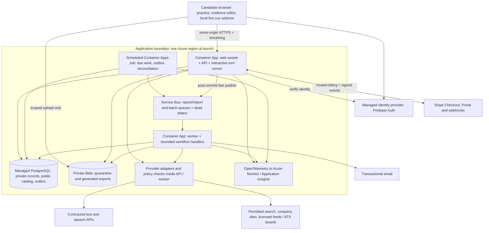
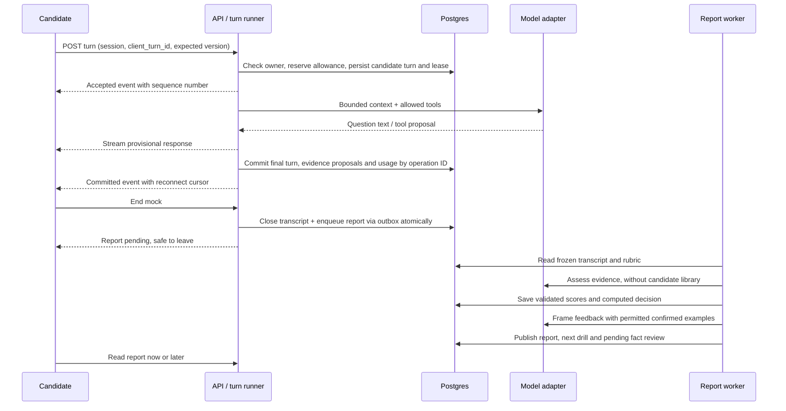

# Architecture and request flows

**One career conversation, a separate scored mock, and a live reminder view.** Chat can gather experience, rehearse a question, search for jobs or plan an interview without changing conversation types. The live guide selects prepared cue cards, not generated answers.

**Implemented boundary:** the [local studio](../README.md#run-the-practice-studio) serves React from ASP.NET, with SQLite persistence, a loopback coach and an in-process daily search worker. The cloud topology below is a proposed deployment, not a prerequisite.

### What to borrow from Understory

The [Understory reference](https://github.com/k-rush/understory) is access-controlled. Its bounded tool loop, capped history, streaming responses, operation traces, replay/live evaluation split and deployment-triage skills are useful precedents. Reuse those **patterns**, not private source, infrastructure identifiers or prompts. Keep the familiar .NET, Azure Container Apps, Blob, managed identity, OpenTelemetry and infrastructure-as-code workflow.

| Deliberate change | Reason / alternative considered |
| --- | --- |
| Web first, not a native mobile client | A candidate commonly starts with a desktop document or a job URL. Responsive web and push-to-talk cover the phone use case with one release train. Revisit native if mobile recording is a demonstrated blocker. |
| Postgres instead of a document store as the system of record | Confirming a claim must atomically connect its source, advance a revision and invalidate dependent work. Relational constraints also fit ledgers, deduplication and deletes. At low volume a managed DB has a real fixed floor; budget it rather than adding separate memory, vector and scheduler services. |
| Server-owned turns and durable work instead of sending a history list from the client | A user must resume on another device, correct a claim, or receive a report after disconnecting. Client history and model-provider threads are neither authoritative nor a deletion boundary. |
| Task-specific prompts and tools, not autonomous agent-to-agent delegation | A grader must not quietly search the candidate's library; a researcher must not see their resume. Separate capabilities and budgets matter more than separate services. |

### Deployable boxes



Run one warm API replica for a paid interactive launch; prelaunch can tolerate cold starts. Scale the worker on queue depth down to zero. The timer uses the worker image with a different command; it is not a scheduler per user. Use private database access, separate identities per deployment, Key Vault for provider secrets, and separate **staging and production** resources. No Kubernetes, always-on inference, graph DB, Redis, message per streamed token, or general-purpose web browser for the model. Use Postgres full-text search and explicit links first; consider `pgvector` only if a labeled retrieval benchmark shows missed relevant stories. Use a CDN/edge tier when latency or traffic warrants its fixed cost.

### Runtime capabilities

Each run pins a prompt, tool schema, model routing policy and input revision. The server supplies the authenticated owner and a purpose to the tools; a model-generated owner, URL, query or instruction is never authority. Tools have JSON schemas, length/row limits, timeouts, cancellation, and allowlisted operations. External text is data, not policy.

| Role | Sees / may do | May not do |
| --- | --- | --- |
| Context builder | Goal, current session, selected relevant facts; ask one question, propose typed nodes/facts/links with evidence. | Confirm a proposal, change an old fact, or fill missing outcomes with estimates. |
| Researcher / planner | Sanitized company + role, permitted sources; create a dated source pack. Combine the pack with the private JD inside the app to create original questions, competencies and probes. | Put resume/JD text into a web query, claim questions are guaranteed, or follow arbitrary URLs. |
| Mock interviewer | Pinned round plan, role, optional approved project titles for context, recent answers and competencies not yet probed. Ask a question or follow-up and mark coverage. | Read model answers, award points, give hints in scored mode or search the web mid-answer. A separate extractor proposes facts from **candidate** turns. |
| Grader then feedback coach | First call: only candidate/interviewer transcript, pinned rubric and role requirements. Validate turn references and compute threshold in code. Second pass: add relevant confirmed library examples, rewrites and drills. | Improve the grade with unused facts, change the pinned rubric, infer protected traits, or silently turn suggested phrasing into facts. |
| Live cue selector (not a chat agent) | Before the round: match target competencies to confirmed, live-allowed project labels and generic prompts. During the round: select from the approved deck. | Call a model or search for answers during the interview, write memory, produce a transcript, or invoke the grader. |
| Job search | Disclose the public source and confirm the role title. Retrieve up to five public links and compare their titles with the owner's chats, memory and history locally. | Send private matching context to search; treat links as confirmed vacancies or application evidence; apply or send outreach. |

Use a small, fast model for extraction, clarification, routine turns and shortlist explanations. Reserve a stronger model for the final rubric assessment, ambiguous evidence, and application writing; run a second assessment only when a validation/disagreement rule requires it. Start with a maximum of three model/tool cycles per interactive turn, one repair for invalid structured output, and a wall-clock deadline; repairs count against the budget. On exhaustion, ask a clarifying question or mark the operation pending, not "try until it works." See [budgets, quality gates and fallbacks](operations.md).

The host, not the model, owns session transitions. A builder goes `active <-> paused -> closed` with a review inbox and recap. A mock goes `preparing -> ready -> active <-> paused -> grading -> reported`; an early end goes to `incomplete` with a continuation action. Ending atomically freezes the scored transcript, so a late voice callback can't change a finished grade. A drill or a retry after a verdict starts a linked attempt. The daily scout has no conversational session: it is a resumable job with explicit steps and a terminal `complete`, `partial`, `failed` or `cancelled` state.

### 1. Onboard and build context

1. Keep **experience** intake separate from **job target** intake. Dropping a file in Job experience or Chat opens a new import conversation without asking for metadata. The browser extracts readable text locally and posts passages with their locations to `POST /api/experience/documents`. The original file is not stored. Offer free-form paste for redaction or unsupported files.
2. For a portfolio, project page or repository link, the same import flow saves a private source card. Fetch only the selected, permitted public page using the restricted fetch adapter; record its canonical URL, retrieval date, revision/hash and relevant section. No site crawl, repository clone or authenticated fetch. On denial or a changed page, keep a bookmark and ask for an authorized excerpt; never infer contribution from the link. A LinkedIn URL is also a pointer: [OIDC](https://learn.microsoft.com/en-us/linkedin/consumer/integrations/self-serve/sign-in-with-linkedin-v2) does not grant work history. Use the candidate's own export/paste unless a scoped integration is approved.
3. The [import harness](#document-import-agent-and-search) reads the attachment and searches existing work history. It commits the description, citations, new proposals, and chat report together. Candidate confirmation and separate use permissions, not the AI summary, determine which statements can enter an application or live reminder. The public research cache never receives personal evidence.
4. `POST /api/chats` starts an ordinary conversation with no kind or import required. Both rehearsal and scored mock answers can add or corroborate a statement, with verbatim provenance and linked, editable memory. An exact match never changes an existing claim's permissions. Only confirmed facts permitted for drafts can enter the base resume.

#### Document import agent and search

**Decision:** use a bounded, in-process .NET workflow with the existing local model and SQLite. An agent *harness* is the code that supplies evidence to the model, dispatches tools, checks the result and decides what can be written. This task has a known sequence, so the host always performs both reads; a small model cannot accidentally omit the history search or issue arbitrary queries.

```text
Drop / choose file -> new private chat + pending text attachment
  -> read_attachment: numbered text from this session, one batch at a time
  -> search_history: ranked records from this workspace's jobs, projects, situations and current claims
  -> local AI: short description + cited entries + possible match numbers
  -> reconcile in a transaction against current history
       exact existing claim -> add source support, keep approved wording and permissions
       new claim            -> file as unconfirmed, with a source location
       ambiguous identity   -> chat asks which record, keep separate, or skip
```

**Search is not proof of identity.** The read tool ranks lexical overlap across the owner's whole library before limiting the model packet to eight hits. It excludes notes, mock answers and other tenants. The writer separately checks exact claims and same-kind labels against current records, including those outside the model's shortlist. A same-title job with no corroborating employer, dates or statement is not enough to silently merge jobs. A possible alias is a question, not a write authorization. Source correction and deletion act on authoritative SQLite rows; there is no embedding cache to invalidate.

**Failure and privacy:** opening an upload chat is distinct from committing a library update. Refreshing or reopening a pending chat retries its attachment. A failed batch leaves history unchanged; a successful run clears the pending document text, keeping only the description, cited evidence and any unresolved questions. Replaying a completed analysis does not file it twice. The single-host runner serializes document inference; it is not a distributed queue. Session history and review decisions persist across restarts. No upload goes to GitHub, OpenAI or a public search engine.

| Option researched | What to borrow, and why not use it here |
| --- | --- |
| [GitHub Copilot agent loop](https://docs.github.com/en/copilot/how-tos/copilot-sdk/features/agent-loop) and [SDK sessions/tools](https://docs.github.com/en/copilot/how-tos/copilot-sdk/features) | Copilot documents a model requesting search/read tools and receiving their results in subsequent turns. Borrow the session and narrow-tool pattern, not a coding agent's shell or repository access. GitHub also documents [semantic repository indexing](https://docs.github.com/en/copilot/concepts/prompting-and-context/repository-indexing) for specific Chat/cloud surfaces; that is not evidence every CLI search uses the same index or ranking algorithm. |
| [OpenAI Agents SDK](https://openai.github.io/openai-agents-python/) | Function tools, guardrails, sessions, handoffs, human approval and tracing are useful for broader tool-driven conversations. This import needs neither a handoff nor another service; tracing private source text would need its own retention controls. |
| [LangGraph persistence](https://docs.langchain.com/oss/python/langgraph/persistence) | Thread checkpointers and cross-thread stores make sense for branching, multi-day workflows. Here the SQLite chat stage is the checkpoint and job history is the shared store. Consider a graph runtime if recovery must resume individual batches across workers. |
| [SQLite FTS5 / BM25](https://www.sqlite.org/fts5.html#the_bm25_function) or local semantic retrieval | FTS5 would add an indexed lexical shortlist as collections grow. Embeddings could retrieve paraphrases with no shared words, at the cost of model inference, storage and deletion synchronization. Evaluate on known duplicate, alias, different-employer and conflicting-claim pairs before adding either. Track shortlist recall, incorrect automatic links and the share needing clarification separately. |

### 2. Prepare, run and grade a mock

`POST /targets` accepts a file, pasted JD, permitted URL or a free-form goal. Normalize requirements into must-have/nice-to-have/unknown and let the candidate edit level, round and focus. Start a background preparation run keyed by target revision; UI shows what's ready and offers **start with role-only research**. Freeze the source pack, rubric and intended competencies when the mock starts. Late-arriving research is for the next attempt.

An optional [interview prep schedule](experience.md#interview-prep-schedule-and-readiness) belongs to that target, not to the daily job scout. The coach suggests activities from the time remaining and the latest comparable feedback; ordinary calendar arithmetic fits blocks inside declared availability and before the interview. Save or move them only on confirmation. An opt-in reminder uses the existing notification outbox, keyed by block and revision; discard superseded reminders. **Start mock** opens the normal session flow. A published scorecard links back to its block; the readiness view compares stored rubric scores without another model call. Moving or missing a block neither spends credit nor changes a grade.

For a named company, first look for official careers/leadership materials (e.g. [Amazon's published principles](https://www.amazon.jobs/content/en/our-workplace/leadership-principles)), then reliable public role materials, then permitted candidate-reported themes. Have a distinct **Glassdoor lookup** capability: use a licensed or otherwise expressly permitted source only within its search, storage, display and attribution rights. Without clearance, offer a candidate-opened link and label that source *not consulted*; do not proxy searches to reconstruct question text. [Glassdoor terms](https://www.glassdoor.com/about/terms/) require review before enabling the adapter. A 403, login wall, absent results or expired license is a normal outcome. Explain which information is official, anecdotal, or a coach inference. Generate original practice questions, not copied question banks.

For example, a pack can cite an official ownership principle and pair it with a JD's rollout responsibility. The planner might ask, **"A rollout is safe for your team but risky for the team on call. When have you owned a decision like that?"** Label it *generated practice question*, not *previously asked at this company*.



For **both** session types, push-to-talk sends a bounded audio turn through the authenticated API to speech-to-text; candidate corrects/accepts the caption, then it follows the identical turn path. A committed assistant reply can be spoken with streamed TTS; stop playback on interrupt and stop the mic on pause. Keep raw audio transient, never put it on the queue. Text works with voice permissions denied, quota exhausted, or a speech outage. Full-duplex realtime audio is a later latency experiment, not a second memory system.

Use streamed HTTP events for the response. Token deltas are provisional; durable events have a sequence number. On reconnect, `GET /sessions/{id}/events?after=seq` replays accepted/final events; reposting the same client turn returns its existing operation. One in-flight reply per session; a second tab with a stale version refreshes rather than appending a duplicate. Expired leases can be reclaimed; never hold a database transaction open during a model call. A missed deadline shows *answer saved, reply pending* and offers a retry or resume. A failed grade stays pending/incomplete, not a no-hire.

### 3. Show live reminders during a real interview

1. **Prepare:** `POST /cue-decks` takes a target (or goal). Rank approved project labels by competency fit using existing evidence links. Fill up to five slots with short templates such as `Mention {project_label}.` and `What changed as a result?` The candidate previews and approves the exact cards. Never display a raw review or referral excerpt, a model answer, or the interviewer's question.
2. **Start and select:** fetch the scoped deck after the candidate confirms notes are allowed. A browser selector maps a topic or answer-stage tap to an uncovered card. **Covered** suppresses repeats; **Later** defers it. Manual mode requests no mic permission. Optional adaptive mode, only with explicit interview/participant permission, uses an on-device keyword detector for coarse topic/stage signals from audible speech. It may pick a card at a pause, never compose one. Low confidence means stay quiet; cap automatic changes at one per 30 seconds. Manual actions take precedence.
3. **Fail quietly:** no meeting bot, screen/system audio capture or cloud speech fallback. If local processing is unavailable or permission is withdrawn, stop the mic; manual selection remains available. Pause suspends all cue changes and capture. Revalidate the deck before showing a personalized card; a profile-change event or expired authorization clears a stale card already on screen. If the deck can't be revalidated, show an approved generic cue or stay silent. Keep current card and coverage in volatile browser memory only. **End** releases the mic and clears live state; there is no live `session`, billing meter, transcript or report job.

### 4. Find jobs in chat and optionally repeat daily

Chat asks for a public role title, or suggests one for confirmation. Only that title leaves the host. The installed public source returns links; the server orders them using wording from the title, recallable user messages, current agent memory and job history in the same workspace. Explanations describe shared wording, not an assessment of qualifications or a guarantee that a job is open. Empty and unavailable searches are distinct.

An affirmative reply after a report and the toggle in Account both update `/api/account/daily-search`. Neither action performs another search. While the host is running, the scheduler checks due searches and puts results in chat history. Old board subscriptions, filters and stored targets never authorize a new public lookup. Historical reports and still-valid approved documents remain available.

### Failure boundaries

Database changes and outbox rows commit together; fast-publish after commit for low latency, with a [scheduled job](https://learn.microsoft.com/en-us/azure/container-apps/jobs) draining stranded rows every minute. Messages contain opaque run IDs, not resumes or prompts. Workers claim `(run, step, input_version)` with an expiring lease, checkpoint output, then acknowledge. Retry transient errors with jitter and `Retry-After`; after five failed deliveries move work to the [dead-letter queue](https://learn.microsoft.com/en-us/azure/service-bus-messaging/service-bus-dead-letter-queues). Validation/rights errors are terminal or need user input, not retryable. Separate report/import capacity from daily discovery and put concurrency ceilings on each provider.

Fence commits with the current lease generation: a stale worker that returns after a timeout cannot replace the winning reply or score. If the model is down, keep committed inputs and show pending work; use an alternate deployment only if already evaluated and permitted for that data. If the database cannot accept a turn, show **not saved** and leave the text in the current browser form for retry. Never display an acknowledgment that cannot be recovered.

This is **at-least-once**, not distributed exactly-once. Deduplicate the *effect* (one accepted turn, scorecard, draft version, allowance debit or digest) with DB constraints. Use a stable provider idempotency key where supported. A provider may bill for an ambiguous timeout; reconcile actual spend separately from the user's allowance. For an ambiguous email send without provider deduplication, don't blindly resend: the in-app digest already exists. For health targets, kill switches and recovery, see [operations](operations.md).
