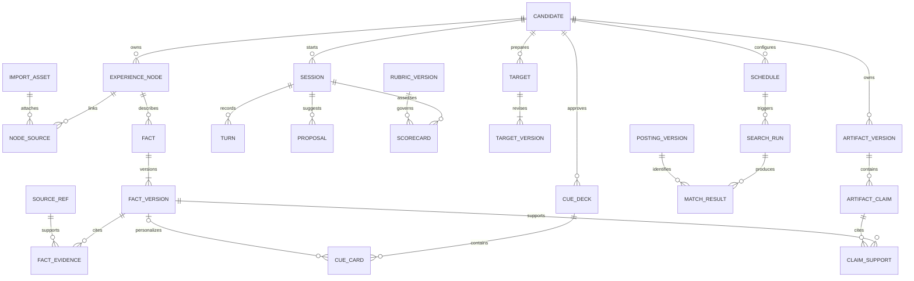

# Data model and memory

**A transcript is evidence of what was said. A confirmed fact is what the candidate agrees may represent them. A scorecard is a judgment about one performance. They are not interchangeable.** PostgreSQL owns all three. The LLM context window, a search index and a provider's chat history own none of them.

### Logical model

The diagram shows key relationships, not every FK. `candidate_id` is the security boundary for private records; a separate read-only catalog holds only material licensed for cross-candidate reuse.

Use UUIDs, UTC instants, explicit status enums, schema versions, and transactions with optimistic versions. Every private FK includes `candidate_id` and the referenced key; a valid ID from another tenant is not a valid reference. Typed columns enforce identity, ownership, status and relationships; JSONB is for validated, versioned attributes (e.g. rubric anchors or parsed constraints), not one opaque "memory" blob.

| Area | Principal records, fields and invariants |
| --- | --- |
| Account and purpose | `candidate(id, issuer, subject, profile_revision, timezone, deletion_state)`; unique `(issuer, subject)`. `consent(purpose, policy_version, granted_at, revoked_at)`. Separate contact/billing identifiers from model context. `goal` stores desired role/level, geography, work preferences, explicit exclusions; never infer them from demographic proxies. |
| Experience primitives | `experience_node(id, kind, display_label)` for employment/role, project, story and skill; typed `experience_edge(from, relation, to)` for role-has-project, story-about-project, demonstrates-skill. Allow independent projects and stories spanning jobs. `fact(id, node_id, field, current_version)` and `fact_version(fact_id, version, value, unit, status, allowed_uses, confirmed_at)` represent titles, partial dates, responsibilities, personal actions, team scope, outcomes, qualifications. Uses distinguish private preparation, live reminders and drafts. A display label or permission for one use does not grant the others. |
| Private evidence sources | `import_asset(id, category, input_kind, title, blob_key?, safe_url?, content_hash?, retrieved_at?, parse_status, allowed_uses, expires_at)` covers file, link or paste. Distinguish resume, review, written referral, project artifact, other evidence and JD. `node_source(node_id, asset_id)` attaches even a bookmark to one or more projects without asserting authorship. Reviews/referrals default to private preparation. Keep the candidate's association with a public project URL private. |
| Provenance and changes | `source_ref(kind, asset_id + page/section/span OR turn_id/span OR manual_attestation, speaker_role, minimal_redacted_excerpt, retention)`; `fact_evidence(fact_id, version, source_ref_id)`. Validate exactly one origin, allow several independent sources per fact, distinguish third-party opinion from a candidate's own action. Use a fact only with support permitted for that purpose. `proposal(patch, source_refs, origin_run, base_revision, status, dedupe_key)` records conflicts for review. |
| Session memory | `session(kind=builder/mock, state, target_version?, profile_revision_at_start, rubric_version?, last_seq)`; `turn(session_id, seq, speaker, text, client_turn_id?, modality)`; `session_event(seq, kind, operation_id)` for durable replay. `checkpoint(session_id, through_turn, summary, open_questions, coverage, evidence_ids)`. `practice_memory(competency, rubric_version, last_attempt, next_drill)` is optional cross-session recall, not an experience fact. |
| Interview prep plan and progress | `prep_plan(id, target_version, round, interview_at, timezone, availability_windows, revision)`; `prep_block(id, plan_id, kind=mock/review/drill, starts_at, duration, state, linked_attempt_id?)`. Keep planned time separate from actual completion. Read progress from completed scorecards, or from an opt-in `attempt_summary(attempt_id, completed_at, target_version, level, round, rubric_version, competency_points, coverage, grade, verdict)` after a detailed report expires. One result per attempt, not per scheduled block or report retry. Recompute trends for comparable results after deletion or correction. |
| Live reminders | `cue_deck(id, target_version_or_goal, revision, approved_at)`; `cue_card(deck_id, position, topic, template_id, approved_label?, fact_version_id?)`. A personalized card requires a current, confirmed, live-allowed fact version and candidate approval of the rendered line. A generic "what changed?" card needs no supporting fact. Store the prepared deck, not meeting audio, questions, detected topics or covered-card history. No FK to a scorecard. |
| Target and sources | `target` + `target_version(input_kind, goal_id?, private_jd_ref?, public_posting_version?, requirements, level)` support a resume-free and JD-free start. `source_policy(source, rights_basis, allowed_operations, scope, expires_at, ttl)`, `source_item(url, publisher, retrieved_at, content_hash, trust_class, policy_id)`. `research_pack` pins claims to source IDs, dates and confidence; `round_plan` pins pack, target, competency probes and immutable rubric version. Private input stays private even if its text resembles a public posting. |
| Assessment and feedback | `rubric_version(role_family, level, anchors, weights, must_have_floors)`; `scorecard(session_id, transcript_revision, rubric_version, score, grade, verdict, confidence, status)`, unique per attempt/revision; `score_item(competency, points, turn_refs, rationale)`; `coaching_note(unused_fact_versions, reframing, missing_example, next_drill)`. `feedback(target_type, target_id, run_id?, vote, reason, consent_to_review)` covers messages, grades, matches, drafts and prepared cards. A cue rating doesn't need a record of the real interview. One active vote per candidate/target; a challenge is a separate review request. |
| Search and drafts | Public `board`, `posting(source, external_id, canonical_employer, canonical_url)`, `posting_version(hash, first_seen, checked_at, closed_at?, normalized_requirements)`. Unique source + external ID; group probable cross-source duplicates without merging on title alone. Private `schedule(local_time, tz, next_due_at, enabled, auto_draft)`, `search_run(schedule_id, local_date, goal_revision, status)`, `match_result(run_id, posting_version, evidence, unknowns)`, `job_action(canonical_job, saved/dismissed/applied_by_user)`, `digest(run_id, delivery_state)`. `artifact_version(kind=base_resume/tailored_resume/letter, target_version?, profile_revision, review_state, blob_key?)`; `artifact_claim(span, kind)` + `claim_support(fact_version_id)` support sentence-level provenance and reverse invalidation. |
| Operating records | `agent_run(operation_id, owner, purpose, input_versions, policy_versions, status, lease_until, cost_limit)`, `step(run_id, key, attempt, state, output_ref)`, `outbox(effect_key, not_before, state)`, unique `inbox(provider, mode, event_id)`, and privacy-safe `audit_event`. `eval_result(run_id, rubric_or_check_version, slice, outcome)` stores scores, not unsolicited training data. |
| Billing | `billing_customer(candidate_id, stripe_mode, customer_id)`, `subscription(provider_id, price_id, status, period_start, period_end, cancel_at?)`, append-only `invoice_entry(provider_entry_id, invoice_id, kind, amount_minor, currency)`. Scope provider keys by test/live mode. Map one customer per candidate per mode; record receipts and adjustments once per financial entry, not per webhook delivery. Never store card details. |
| Entitlements and usage | `entitlement(candidate_id, grant_key, meter, allowance)` is unique on candidate/grant/meter. The free grant key is lifetime; the paid key includes subscription and invoiced period. `usage_reservation(grant, operation, units, expires_at)` holds capacity; append-only `usage_entry(grant, effect_key, units)` settles each billable effect once. Record provider attempts/cost separately: a retry can cost money without consuming a second mock. Anonymous demo activity creates none of these records. See [billing transitions](operations.md#billing-and-unit-economics). |

Indexes that pay for themselves early: unique `(candidate_id, session_id, client_turn_id)` on candidate turns and one final reply per turn operation; unique `(session_id, seq)` on ordered events; `fact(candidate_id, node_id, field)` with a current-version FK into `fact_version`; GIN full-text on permitted searchable fields; reverse `fact_version_id` on claim support; `(enabled, next_due_at)` on schedules; unique `(schedule_id, local_date)`, `(run_id, step_key)`, `digest(run_id)` and `outbox(effect_key)`. A user's dismissal is keyed by canonical job, not today's posting version. Blob keys are opaque and never act as authorization.

### Promotion, correction and forgetting

1. **Capture:** a builder turn says "I piloted it with two teams." Extraction proposes `project=release tooling; action=piloted rollout; scope=2 teams`, linked to that turn. A mock turn can independently propose "I wrote the rollback guide." Neither is retrieved as a resume fact. Document extractions follow the same path. A generated rewrite cannot be an evidence source.
2. **Review:** show the actual excerpt or page and the proposed normalized value. Candidate approves, edits, rejects, or marks interview-only. Approval is a user-authorized transaction: check the base revision, create/advance nodes and fact versions, record the source/attestation, increment `profile_revision`, emit `profile.changed` via outbox. Replays return the prior result. Concurrent change returns a diff for review. "Confirmed" means *candidate-attested*, not employer-verified.
3. **Use:** the library might now contain `F12@1: piloted with two teams`. A tailored sentence cites `F12@1`; it cannot infer "reduced incidents by 30%." A scored answer may mention something not yet confirmed: evaluate it as a self-reported answer and optionally propose it, never promote it silently.
4. **Correct:** changing two teams to one creates `F12@2`, supersedes `@1`, and marks dependent drafts and live cards stale. Export and cue display check the authoritative version/exclusions, even if reindexing hasn't caught up. Show what needs reapproval. Old scorecards describe the performance as delivered, with a stale-context notice if relevant; retries are separate records.
5. **Forget:** remove the fact from retrieval immediately; traverse evidence, excerpts, summaries, indexes, derived drafts, cue cards, report suggestions and export blobs, then purge or redact affected copies. Withdraw old download links. When forgetting source text too, redact matching referenced turns or remove the session rather than re-extracting the claim next turn. Previously downloaded files are outside the service's control. Explain *delete source only* versus *forget linked facts everywhere*. After source deletion, keep a fact for a given use only if independently supported by another permitted source or explicitly re-attested by the candidate.

### Session recall without a growing prompt

For each turn assemble a purpose-limited packet: system policy and tool schemas; pinned goal/round and competency coverage; a checkpoint with source turn IDs; recent turns; top relevant **permitted** facts. Example starting budget: 1.5k tokens for policy/tools, 1.5k for goal/research, 1k summary, 2k recent turns, 2k for up to six fact snippets. Drop low-ranked snippets first, then compact older turns. Preserve space for the response. Summarize past a threshold or on pause, store `through_turn`, and replay only the tail. Rebuild invalidated checkpoints from surviving events; summaries are fallible caches, never evidence.

Retrieval first constrains by authenticated owner, current/approved version, purpose and exclusion flags, then traverses project/story/skill links and ranks text relevance. Use a minimum relevance threshold; no match should yield a question, not the closest unrelated story. Session resume restores the exact round, outstanding probe and last committed turn. A new mock may recall an earlier weak competency if enabled, but **the grading packet excludes all library facts and prior grades**. Don't rely on telling a model to ignore facts it already has.

### Retention contract proposed for the pilot

| Data | Default |
| --- | --- |
| Raw voice / partial transcription | Transient processing only; no application recording. Confirm contracted provider retention and disclose any exception before offering voice. Only accepted transcript text enters memory. |
| Uploaded originals / project pages / exports | Quarantine, then expire raw reviews, referrals, other originals and fetched page copies within 7 days. A saved bookmark and approved redacted excerpt can remain; label the original expired. Retain parsed private target details while saved. Expire generated download blobs after 24h and regenerate from approved versions. |
| Live guide | Keep approved decks until removed or invalidated. Mic buffers and topic signals are transient and local; discard immediately after matching. Clear the displayed card and checklist on exit. No meeting recording, transcript, or interview-content telemetry. |
| Turns, working summaries, rejected/pending proposals, detailed reports | 30 days after session activity/closure or earlier on delete. Show expiry in UI. Unreviewed facts expire, not auto-approve. Keeping compact score history and next-drill recall beyond that window is opt-in; neither contains answers or transcript quotes. Deleting an attempt removes its saved summary and trend point. |
| Confirmed library / evidence | Keep until candidate deletes it. Approval explains whether a minimal supporting excerpt will persist after its source expires; candidate may keep only their own attestation. Don't preserve an entire expired document in excerpts. |
| Private digests/drafts / account deletion | Keep saved text versions until removed, subject to evidence deletion; expire unsaved search results after 30 days. Revoke access and queued work on account deletion immediately; target live purge within 24h. Encrypted backups cycle out within the documented 30-day window. Keep only separately required financial records under a published jurisdiction-specific policy. |

Separate private and licensed-public schemas, database roles, caches and storage prefixes; a candidate-uploaded JD or company pack incorporating private material is **never** shared. Row-level security is defense in depth, not a substitute for scoped joins and authorization. See [operations](operations.md) for restore-time deletion guards, processor boundaries and access controls.
